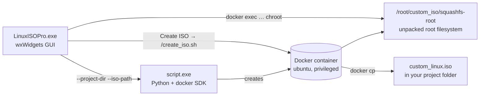

# LinuxISOPro

[](https://github.com/OldFansBG/LinuxGUI/actions/workflows/build.yml)


**LinuxISOPro** is a Windows desktop app for building your own Linux live ISO. Pick an existing ISO
(Linux Mint, Ubuntu, Debian, Arch, ...), customise it in a GUI, and get back a bootable ISO with your changes.

Docker does the Linux work, so you don't need a Linux machine or a VM.

## Features

- **Distribution detection.** Reads `grubenv` / `os-release` straight from the ISO with libarchive
  and finds the root filesystem (`filesystem.squashfs`, `airootfs.sfs`, ...).
- **Desktop environments.** Shows which desktop the image uses and switches it to GNOME, KDE Plasma,
  XFCE, Cinnamon, MATE, LXQt, Budgie, ... (Debian/Ubuntu based images).
- **Flatpak app store.** Search Flathub and install apps directly into the image. "Show Installed" lists
  what is already there.
- **System settings.** Hostname, language, keyboard layout, timezone, a user account with sudo,
  and root account lock/password.
- **Wallpaper.** Keep a local wallpaper gallery and set any of the images as the default background
  (GNOME, Cinnamon, MATE).
- **App sets.** Save lists of Flatpak apps as JSON, then download or "Load & Install" them in one click.
  They are stored in the project folder, with optional MongoDB Atlas sync.
- **Embedded terminal.** A shell inside the image's chroot, for anything the GUI doesn't cover.
- **One-click ISO build.** Repacks the filesystem and writes a new ISO that keeps the original
  BIOS + UEFI boot setup (`xorriso -boot_image any replay`).

## How it works



1. **Setup.** `script.exe` starts a privileged `ubuntu` container, copies the ISO into it and unpacks
   the root filesystem to `/root/custom_iso/squashfs-root`. It also mounts `/proc`, `/sys` and `/dev`
   so the folder works as a chroot.
2. **Customise.** Every tab runs its commands inside that chroot (`apt-get`, `flatpak install`, `useradd`, ...).
3. **Create ISO.** `create_iso.sh` cleans up the chroot, compresses it back into a squashfs and writes
   `custom_linux.iso` from the original ISO, replacing only the root filesystem. The ISO is then copied
   to your project folder.

Closing the project window deletes the container.

## Requirements

- Windows 10 or 11 (64-bit)
- [Docker Desktop](https://www.docker.com/products/docker-desktop/) with the WSL 2 backend, running
- About 3× the ISO size of free disk space for Docker
- An internet connection (Ubuntu image, apt packages, Flathub)

## Download

Every push builds a ready-to-run package. You can download it from the
[Actions tab](https://github.com/OldFansBG/LinuxGUI/actions/workflows/build.yml): open the latest run and
download the `LinuxISOPro-windows-x64` artifact.
Tagged versions (`v*`) are also attached to [Releases](https://github.com/OldFansBG/LinuxGUI/releases).

Unzip it, start Docker Desktop and run `LinuxISOPro.exe`.

## Usage

1. Click **Browse** and pick an ISO, then click **Detect**.
2. Enter a project name and choose an empty **working directory**. The ISO, logs and settings for this
   project go there.
3. Click **Next**. If the ISO contains several filesystems, pick the root filesystem.
   Preparing the container takes a few minutes the first time.
4. Customise the image in the **CONFIG** tabs (Desktop, Applications, System, Customize) or in the **TERMINAL**.
5. Click **Create ISO**. When it finishes, `custom_linux.iso` is in your working directory.

If setup fails, the details are in `logs/iso_builder_*.log` next to `LinuxISOPro.exe`.

## Building from source

The app builds with the [MSYS2](https://www.msys2.org/) UCRT64 toolchain.

```bash
pacman -S --needed mingw-w64-ucrt-x86_64-{gcc,cmake,ninja,wxwidgets3.2-msw,libarchive,yaml-cpp,rapidjson,curl}
```

Then run `build.bat` from the repository folder. It configures CMake, builds `build\LinuxISOPro.exe` and
copies the DLLs it needs next to it. From an MSYS2 UCRT64 shell you can also build directly:

```bash
cmake -S . -B build -G Ninja -DCMAKE_BUILD_TYPE=Release
cmake --build build
```

The Docker backend is a Python script, packaged as `script.exe` with PyInstaller. Put it next to `LinuxISOPro.exe`:

```bash
pip install -r requirements.txt pyinstaller
pyinstaller --onefile --name script script.py
```

## Optional: MongoDB sync for app sets

App sets are saved as JSON in `<project>/db_files`. To share them through MongoDB Atlas:

1. Build with the MongoDB C++ driver available (for example `vcpkg install mongo-cxx-driver` and pass the vcpkg
   toolchain to CMake). CMake turns the feature on when it finds the driver. Use `-DLINUXISOPRO_WITH_MONGODB=OFF` to skip it.
2. Set your connection string in an environment variable before starting the app. **Never put it in the source code.**

   ```bat
   setx LINUXISOPRO_MONGODB_URI "mongodb+srv://<user>:<password>@<cluster>/?retryWrites=true&w=majority"
   ```

Documents go to the `testdb.config_files` collection.

### App set format

```json
{
  "config_name": "Everyday apps",
  "installations": [
    { "appId": "org.mozilla.firefox", "appName": "Firefox" },
    { "appId": "org.videolan.VLC", "appName": "VLC" }
  ]
}
```

`appId` is the Flathub ID, which you can find on any app's Flathub page. See [`examples/example_config.json`](examples/example_config.json).

## Project structure

| Path | What it is |
| --- | --- |
| `main.cpp`, `MainFrame.*` | App entry point, Docker checks, ISO selection and distro detection |
| `ISOReader.*`, `config.yaml` | Reading files from the ISO (libarchive) and detection rules |
| `SecondWindow.*` | Project window: starts the backend, terminal / config tabs, **Create ISO** |
| `ContainerCommand.*` | Runs scripts in the container's chroot (`docker cp` + `docker exec`) |
| `ConfigTab.*`, `DesktopTab.*`, `SystemTab.*`, `CustomizeTab.*` | The CONFIG sub-tabs |
| `FlatpakStore.*` | Flathub search (libcurl + RapidJSON) and Flatpak installs |
| `MongoDBPanel.*` | App sets: local JSON files and optional MongoDB Atlas sync |
| `WinTerminalManager.*` | Embeds a console window in the TERMINAL tab |
| `ThemeConfig.*`, `themes.json`, `SettingsDialog.*` | Light, dark and high-contrast themes |
| `script.py` | Backend: creates the container and writes `setup_chroot.sh` / `create_iso.sh` |
| `.github/workflows/build.yml` | CI: builds the exe and `script.exe` and packages them |

## Known limitations

- Switching desktop environments uses `apt-get`, so it only works on Debian/Ubuntu based images.
- Images without Flatpak get it installed during setup when the package manager is supported
  (apt, pacman, dnf, zypper, apk, xbps).
- The embedded terminal and the Docker checks are Windows-only. The app targets Windows.
